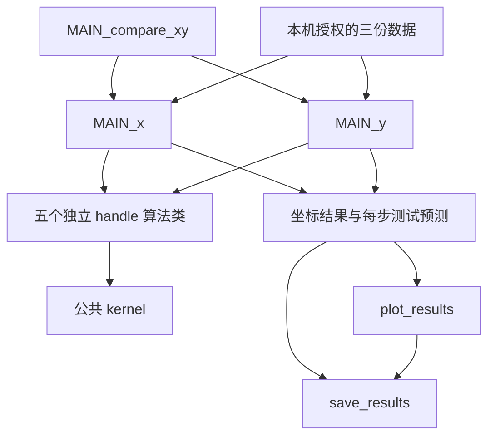

# 架构与代码导读

## 主流程

`MAIN_x.m` 和 `MAIN_y.m` 保留教学顺序：准备数据、选择坐标、创建算法对象、外层遍历算法、内层逐点训练、每步测试、转成 dB、绘图。两个主函数使用函数包装以返回结果，不清空调用者工作区。

`MAIN_compare_xy.m` 调用两个坐标入口，把结果按坐标维度拼接。它不在第三个地方重写算法递推。根目录的五个算法类各自拥有模型状态，不使用旧合并算法分支。

## 五个类的共同接口

| 方法 | 职责 |
|---|---|
| 构造函数 `ClassName(struct(...))` | 读取该类的参数与初始配置 |
| `initial_p(x,y)` | 用第一个训练样本初始化字典和系数 |
| `train(x,y)` | 接收后续单个训练点并更新模型 |
| `evaluate(X)` | 批量预测，输入每行一个样本 |
| `model` | 返回当前字典与核展开系数 |

这些类继承 `handle`，所以方法直接修改对象内部状态。不要把同一个对象同时当成 X 和 Y 两个独立模型使用。

## 类状态

- `dict`：已加入的训练中心，每行一个输入样本。
- `alpha`：KLMS/FrKLMS 中的核展开系数；它在 FrKLMS 中不是分数阶参数，后者名为 `p`。
- `theta`：KRLS/FrKRLS/KRGMC 的核展开系数。
- `P`：递推矩阵，随字典增长。
- `dictAlpha`：FrKRLS 的变换字典，按 `abs(x).^alpha.*sign(x)` 构造。
- `G`、`g`：分数阶或相关熵误差权重，与物理坐标不同。
- `H`、`k`：最近一次核评价缓存；下一次训练会用当前训练点刷新，不能误用上一批测试输入的缓存。

FrKRLS 的两条非对称核向量必须区分，训练和测试的输入表示也要按实现使用。其 `model` 返回原始字典及系数，若要在类外独立重建预测，还必须使用 `dictAlpha` 或组合结果中保存的变换中心。

## 结果维度

| 字段 | 大小 | 含义 |
|---|---|---|
| `results.mse` | 70×5×2 | 每步测试 MSE |
| `results.mseDb` | 70×5×2 | `10*log10(MSE)` |
| `results.variance` | 70×5×2 | 每步测试残差的样本方差 |
| `results.predictionHistory` | 20×70×5×2 | 测试点、迭代、算法、坐标 |
| `results.finalPredictions` | 20×5×2 | 完成训练后的预测 |
| `results.models` | 5×2 单元数组 | 各模型的状态快照 |

算法维度顺序是 KRLS、KLMS、FrKLMS、FrKRLS、KRGMC；坐标维度顺序是 X、Y。训练目标和测试目标均不会因坐标顺序改变而合并成向量输出模型。

`save_results.m` 生成的 MAT 会包含数据、模型及本机源文件路径；它和逐点 CSV 默认被 `.gitignore` 排除，公开前应另行检查，不应直接提交生成目录。
